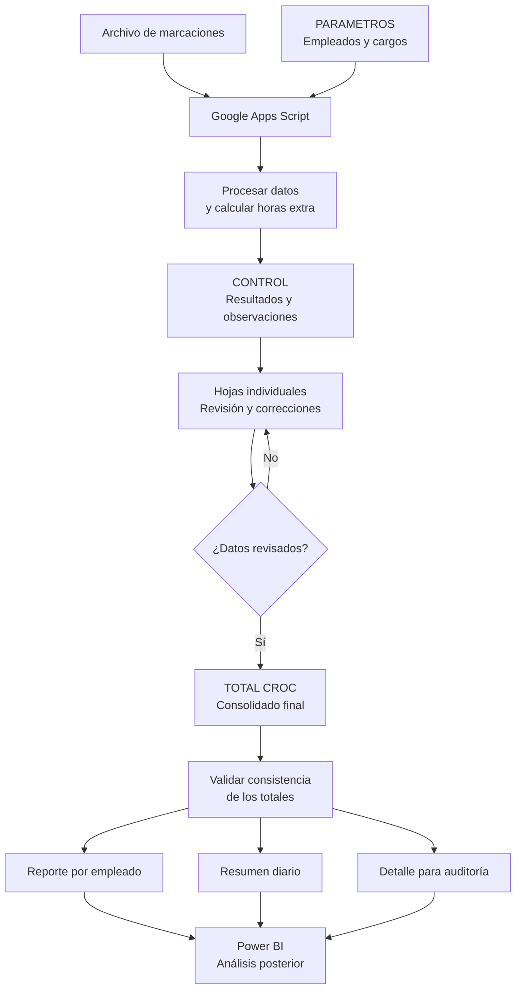

# Automatización de Novedades de Nómina con Google Apps Script

**Automatización de procesos · Calidad de datos · Trazabilidad · Analítica**

[](https://www.google.com/sheets/about/)
[](https://developers.google.com/apps-script)
[](https://developer.mozilla.org/es/docs/Web/JavaScript)

## Descripción del proyecto

Este proyecto consiste en desarrollar una solución de automatización para procesar marcaciones de asistencia, calcular novedades de horas extra y consolidar la información para su revisión antes del cierre de nómina.

La solución utiliza **Google Sheets como interfaz de trabajo y Google Apps Script como motor de procesamiento**, integrando reglas de negocio, validaciones, revisión humana y controles de consistencia.

El proyecto responde a un problema operativo real: la dependencia de tareas manuales para organizar información, aplicar criterios de cálculo y consolidar resultados en un entorno sin un sistema ERP especializado.

> **Privacidad:** este repositorio está diseñado como proyecto de portafolio. Los datos reales de empleados, los archivos de nómina y los identificadores internos no forman parte de la versión pública.

## Objetivos

- Automatizar el procesamiento de archivos de marcaciones de asistencia.
- Estandarizar la aplicación de las reglas de negocio para el cálculo de horas extra.
- Identificar registros incompletos y situaciones que requieren revisión.
- Mantener trazabilidad entre los datos procesados, las novedades calculadas y los resultados consolidados.
- Permitir la revisión y corrección manual antes de generar el consolidado definitivo.
- Preparar información estructurada para análisis posteriores en Power BI.

## Tecnologías utilizadas

| Tecnología | Aplicación |
|---|---|
| Google Sheets | Interfaz operativa, parámetros, control y reportes |
| Google Apps Script | Automatización del procesamiento y consolidación |
| JavaScript | Desarrollo de la lógica de negocio |
| Google Drive | Almacenamiento y acceso a archivos de entrada |
| Power BI | Posible integración posterior para análisis y visualización |

## Arquitectura y flujo del sistema

El proceso separa la automatización inicial de la revisión humana y del consolidado definitivo. Esta separación permite corregir novedades antes de generar la información final.




### Componentes principales

**1. PARAMETROS**

Centraliza la configuración necesaria para procesar el período seleccionado, incluyendo los empleados habilitados, la correspondencia con sus hojas individuales, las áreas y los cargos.

**2. CONTROL**

Registra los resultados del procesamiento automatizado y facilita el seguimiento de las marcaciones, los cálculos realizados y las observaciones asociadas a cada caso.

**3. Hojas individuales**

Presentan las novedades por empleado para su revisión. Los responsables pueden validar y corregir los registros que lo requieran antes de ejecutar la consolidación final.

**4. TOTAL CROC**

Genera el consolidado a partir de las hojas individuales revisadas. Organiza la información por empleado, fecha y detalle, facilitando la conciliación de los resultados.

**5. Menú personalizado**

Permite ejecutar las operaciones principales directamente desde Google Sheets, sin tener que abrir el editor de código para cada ejecución.

## Funcionalidades

- **Procesamiento automatizado:** lectura y tratamiento de archivos de marcaciones mediante Google Apps Script.
- **Homologación de empleados:** normalización de nombres para facilitar la correspondencia entre las fuentes y los registros configurados.
- **Cálculo de novedades:** aplicación de reglas de redondeo y jornadas según los parámetros definidos para cargos y días.
- **Detección de excepciones:** identificación de marcaciones incompletas y casos que requieren validación.
- **Actualización de hojas individuales:** generación y actualización de la información para revisión.
- **Consolidación final:** agrupación de las horas extra por persona y fecha a partir de los registros revisados.
- **Trazabilidad:** conservación de información de control para facilitar la revisión de los resultados.
- **Controles de consistencia:** comparación de los totales por empleado, por día y por detalle.
- **Interfaz operativa:** menú personalizado para ejecutar las funciones del sistema.
- **Preparación para analítica:** organización de los resultados en tablas que pueden utilizarse en herramientas de visualización.

## Reglas de negocio

Las siguientes reglas describen la lógica funcional de la solución. Antes de utilizarla en un entorno productivo, deben contrastarse con las políticas internas vigentes y las disposiciones laborales aplicables.

| Regla | Descripción |
|---|---|
| Período de procesamiento | El período se define mediante los parámetros del sistema. |
| Homologación de empleados | Se normalizan los nombres para reducir diferencias por tildes, espacios y escritura. |
| Redondeo de marcaciones | Las marcaciones se ajustan al intervalo de 15 minutos más cercano, de acuerdo con la lógica implementada. |
| Jornada aplicable | El cálculo considera reglas diferenciadas según el cargo y el día de la semana. |
| Marcaciones incompletas | Los casos con información insuficiente deben identificarse para revisión, en lugar de asumirse automáticamente como válidos. |
| Revisión humana | Los resultados generados se revisan y pueden corregirse antes de la consolidación definitiva. |
| Fuente del consolidado | El consolidado final se construye a partir de las hojas individuales revisadas. |
| Validación de totales | Se comprueba la consistencia entre los totales por empleado, por día y por detalle. |
| Trazabilidad | Las observaciones y los resultados del procesamiento permiten investigar diferencias y excepciones. |

**Importante:** esta automatización es una herramienta de apoyo al proceso de nómina. No sustituye la aprobación del responsable ni la validación legal de las reglas de cálculo. Las condiciones relativas a recargos, festivos, jornadas y horas extra deben configurarse de acuerdo con la normativa vigente y las políticas autorizadas.

## Instalación y configuración

La solución se ejecuta en el entorno de Google Workspace. No requiere instalar un servidor propio, pero sí necesita una cuenta de Google con permisos para crear y editar hojas de cálculo y ejecutar Google Apps Script.

### Requisitos previos

- Una cuenta de Google.
- Acceso a Google Sheets, Google Drive y Google Apps Script.
- El código fuente de la automatización.
- Una hoja de cálculo de prueba con datos ficticios.
- Los parámetros y las reglas de negocio documentados.

### Paso 1. Crear el archivo de Google Sheets

1. Ingresa a [Google Sheets](https://sheets.google.com/).
2. Crea una hoja de cálculo nueva en tu cuenta.
3. Asígnale un nombre descriptivo, por ejemplo, `Automatizacion_Novedades_Nomina_Demo`.
4. Utiliza exclusivamente información ficticia para la configuración inicial.

### Paso 2. Abrir Google Apps Script

1. En la hoja de cálculo, abre el menú **Extensiones → Apps Script**.
2. Se abrirá el editor de código asociado al archivo.
3. Copia el código fuente del proyecto en el editor correspondiente.
4. Guarda los cambios.

> El código fuente debe publicarse por separado de este README. Si el repositorio todavía no contiene el código, este paso quedará pendiente hasta incorporarlo y documentar sus archivos.

### Paso 3. Preparar la estructura de hojas

Crea y configura las hojas que utiliza la solución:

- `PARAMETROS`: configuración del período, empleados y datos de referencia.
- `CONTROL`: seguimiento del procesamiento y sus observaciones.
- `TOTAL CROC`: consolidado final.
- Hojas individuales: una hoja por cada empleado de prueba, con la estructura esperada por el código.

Los nombres de las hojas, encabezados y campos deben coincidir con los que utiliza la versión publicada del código. No se deben inventar columnas ni modificar la estructura sin verificar primero las dependencias del script.

### Paso 4. Configurar los parámetros

1. Registra empleados ficticios en la hoja de parámetros.
2. Define las correspondencias con las hojas individuales.
3. Configura el período que se utilizará en las pruebas.
4. Revisa los cargos y las reglas de jornada aplicables.
5. Comprueba que las referencias estén completas antes de ejecutar el procesamiento.

### Paso 5. Autorizar y ejecutar el script

1. Guarda el proyecto en Apps Script.
2. Ejecuta la función de configuración inicial prevista por el código.
3. Revisa los permisos solicitados y autoriza únicamente los necesarios para el funcionamiento esperado.
4. Regresa a Google Sheets y actualiza la página si es necesario.
5. Verifica que aparezca el menú personalizado de la automatización.
6. Ejecuta primero la opción de prueba disponible en la versión publicada.

Los nombres exactos de las funciones y las opciones del menú deben corresponder al código fuente incluido en el repositorio.

### Paso 6. Validar los resultados

Antes de considerar terminada la instalación:

- Comprueba que las marcaciones de prueba se procesen correctamente.
- Verifica los cálculos con casos de entrada y salida conocidos.
- Prueba el tratamiento de marcaciones incompletas.
- Revisa los resultados en `CONTROL` y en las hojas individuales.
- Corrige las novedades de prueba que corresponda.
- Ejecuta la consolidación final.
- Compara los totales por empleado, por día y por detalle.

**Criterio de aceptación:** el resultado se considera validado cuando las reglas de negocio se aplican correctamente y los totales consolidados coinciden con los datos revisados.

## Estructura sugerida del repositorio

La siguiente es una propuesta de organización para GitHub; los nombres deberán ajustarse a los archivos que efectivamente se publiquen.

```text
automatizacion-novedades-nomina/
├── README.md
├── src/
│   └── codigo_automatizacion.gs
├── docs/
│   ├── arquitectura.md
│   └── reglas_de_negocio.md
├── ejemplos/
│   └── datos_ficticios.csv
└── .gitignore
```

- `README.md`: descripción, funcionalidades e instrucciones.
- `src/`: código fuente de Google Apps Script.
- `docs/`: documentación técnica y funcional.
- `ejemplos/`: datos ficticios para pruebas y demostraciones.
- `.gitignore`: reglas para evitar incluir archivos locales no destinados al repositorio.

No publiques archivos reales de nómina, exportaciones de marcaciones, hojas de cálculo internas ni copias de seguridad con información personal.

## Calidad de datos y controles

El proyecto incorpora controles funcionales orientados a mejorar la confiabilidad del proceso:

- Normalización de datos para facilitar la homologación de empleados.
- Identificación de excepciones que requieren intervención.
- Separación entre procesamiento automático y aprobación humana.
- Revisión de consistencia de los resultados consolidados.
- Trazabilidad de los datos procesados y de las observaciones.

Estos controles son especialmente importantes porque un resultado técnicamente calculado no necesariamente es correcto si faltan empleados en la configuración, existen marcaciones incompletas o las reglas de negocio están desactualizadas.

## Resultados y aprendizajes

La solución permitió estructurar un proceso que dependía de tareas manuales mediante una combinación de automatización, revisión humana y validación de resultados.

Entre los principales aprendizajes del proyecto se encuentran:

- Traducir un proceso operativo en reglas de negocio verificables.
- Utilizar JavaScript y Google Apps Script para automatizar tareas administrativas.
- Gestionar excepciones sin perder el control sobre los registros.
- Detectar problemas de calidad de datos y de interpretación de fechas y duraciones.
- Diseñar controles para conciliar resultados antes de su uso.
- Preparar datos estructurados para análisis posteriores.

Los resultados cuantitativos de la operación original no se incluyen en esta versión pública por motivos de confidencialidad.

## Mejoras futuras

- Crear pruebas automatizadas para las reglas de cálculo.
- Fortalecer los registros de ejecución y el manejo de errores.
- Incorporar reglas configurables para festivos y excepciones autorizadas.
- Automatizar la recepción y organización de archivos.
- Incorporar indicadores de calidad y seguimiento de ejecuciones.
- Diseñar una integración documentada con Power BI.
- Ampliar la documentación técnica y los ejemplos de prueba.

## Seguridad y privacidad

La versión pública debe cumplir las siguientes condiciones:

- Utilizar nombres ficticios para empleados, empresa y áreas internas.
- No publicar documentos originales de nómina ni datos de asistencia reales.
- No incluir contraseñas, tokens, credenciales ni claves.
- No exponer identificadores privados de archivos o carpetas de Google Drive.
- Revisar el código en busca de referencias a recursos internos.
- Utilizar datos sintéticos para capturas de pantalla y demostraciones.
- Verificar que los permisos solicitados por el script sean necesarios para sus funciones.

La publicación del código no implica que deban hacerse públicos los archivos de Google Sheets utilizados durante el desarrollo.

## Autor y propósito.

**Iván Giovanni Ramírez Correa**

Proyecto de portafolio enfocado en **automatización de procesos, análisis de datos y mejora continua**, desarrollado para demostrar cómo las herramientas de Google Workspace pueden utilizarse para resolver problemas operativos y mejorar la trazabilidad de la información.

El proyecto combina comprensión del proceso de negocio, programación, validación de datos y preparación de información para analítica.

---

*Proyecto de demostración. Los ejemplos públicos deben utilizar datos ficticios. La ejecución en un entorno real requiere configuración, pruebas y validación de las reglas aplicables.*

