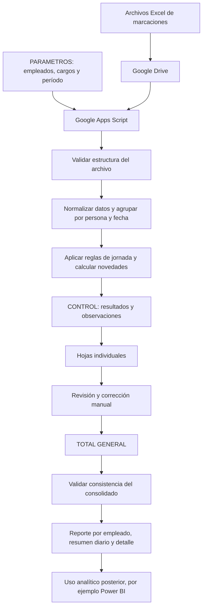

# Arquitectura de la solución

## 1. Propósito

Este documento describe la arquitectura funcional y técnica de una automatización de novedades de nómina construida con Google Sheets y Google Apps Script. La solución procesa archivos Excel de marcaciones, aplica reglas de negocio configuradas, permite revisar los resultados y genera un consolidado.

La implementación publicada debe ejecutarse únicamente con datos ficticios o con datos para los que exista autorización expresa.

## 2. Componentes

### Google Sheets

Es la interfaz principal de configuración, revisión y consulta. La implementación utiliza estas hojas:

- **PARAMETROS:** contiene la configuración de empleados, nombres de hojas individuales, área, cargo, estado activo y período de procesamiento.
- **CONTROL:** registra el resultado del procesamiento inicial, incluyendo archivo de origen, empleado, fecha, marcaciones, horas calculadas, estado y observaciones.
- **Hojas individuales:** reciben los resultados por empleado para revisión y corrección antes de consolidar.
- **TOTAL GENERAL:** consolida la información procedente de las hojas individuales revisadas.

Los nombres y encabezados deben coincidir con los esperados por el código fuente.

### Google Apps Script

Contiene la lógica de procesamiento, validación, normalización, cálculo y consolidación. Incluye un menú personalizado para ejecutar las principales operaciones desde la hoja de cálculo.

### Google Drive

Almacena los archivos Excel de origen organizados según la ruta configurada. El código utiliza una carpeta raíz identificada mediante un ID de Drive, dentro de la cual busca la carpeta del año y la carpeta de nómina.

### Servicio avanzado de Google Drive

La función de conversión utiliza `Drive.Files.create` para convertir temporalmente archivos Excel a Google Sheets y leer sus datos. Para ejecutar esta funcionalidad en un proyecto nuevo, se debe habilitar el servicio avanzado de Google Drive y su API correspondiente.

## 3. Flujo de procesamiento

## 4. Funciones principales

| Función | Responsabilidad |
|---|---|
| `onOpen()` | Crea el menú personalizado de operaciones. |
| `CONFIGURAR_SISTEMA()` | Valida parámetros y prepara la hoja `CONTROL`. |
| `EJECUTAR_PRUEBA()` | Recorre los archivos Excel, valida su estructura y procesa los registros del período configurado. |
| `esArchivoRH_()` | Comprueba que el archivo contenga las columnas requeridas. |
| `procesarExcelPrueba_()` | Procesa los registros, aplica cálculos y registra resultados en `CONTROL`. |
| `ACTUALIZAR_HOJAS_INDIVIDUALES()` | Distribuye la información de control a las hojas individuales para revisión. |
| `ACTUALIZAR_TOTAL_GENERAL()` | Consolida la información desde las hojas individuales configuradas. |
| `VER_CONTROL()` | Abre la hoja de control. |

## 5. Configuración esperada

### Hoja `PARAMETROS`

Las primeras cinco columnas deben tener estos encabezados:

1. `NOMBRE RH`
2. `NOMBRE HOJA`
3. `AREA`
4. `CARGO`
5. `ACTIVO`

La función que obtiene el período de procesamiento lee la fecha de inicio desde `H2` y la fecha de fin desde `H3`.

### Archivos de marcaciones

El código verifica que el archivo de origen incluya las columnas `NOMBRE`, `FECHA`, `HORA` y `MODO`. El procesamiento agrupa las marcaciones por persona y fecha, y utiliza la primera y la última hora identificadas como entrada y salida.

### Zona horaria

La configuración del código utiliza `America/Bogota`. Debe mantenerse coherente con la configuración regional y horaria de los archivos que se procesen.

## 6. Consideraciones de seguridad y privacidad

- No publicar archivos reales de marcaciones ni hojas de nómina.
- No incluir nombres reales, identificadores personales ni capturas con datos confidenciales.
- No publicar IDs privados de carpetas o archivos de Google Drive.
- Sustituir el marcador `REEMPLAZAR_CON_ID_DE_CARPETA` por un ID propio únicamente en el entorno privado donde se ejecute la solución.
- Revisar y conceder solo los permisos requeridos por Apps Script y el servicio avanzado de Drive.
- Utilizar datos sintéticos para las pruebas y demostraciones públicas.

## 7. Límites conocidos

- Las reglas de jornada están codificadas en la función de cálculo; cualquier cambio requiere revisar y probar el código.
- Los cargos que no coincidan con las categorías reconocidas pueden recibir una jornada de cero horas. Deben validarse los cargos y las reglas antes de usar el sistema.
- La lógica de domingo devuelve cero horas de jornada; no debe interpretarse como una regla laboral completa para todos los escenarios.
- La automatización es una herramienta de apoyo. Los resultados deben revisarse y aprobarse por una persona responsable antes de utilizarlos para liquidar nómina.
- La conexión con Power BI se contempla como uso analítico posterior; no se documenta aquí como una integración automática ya implementada.

